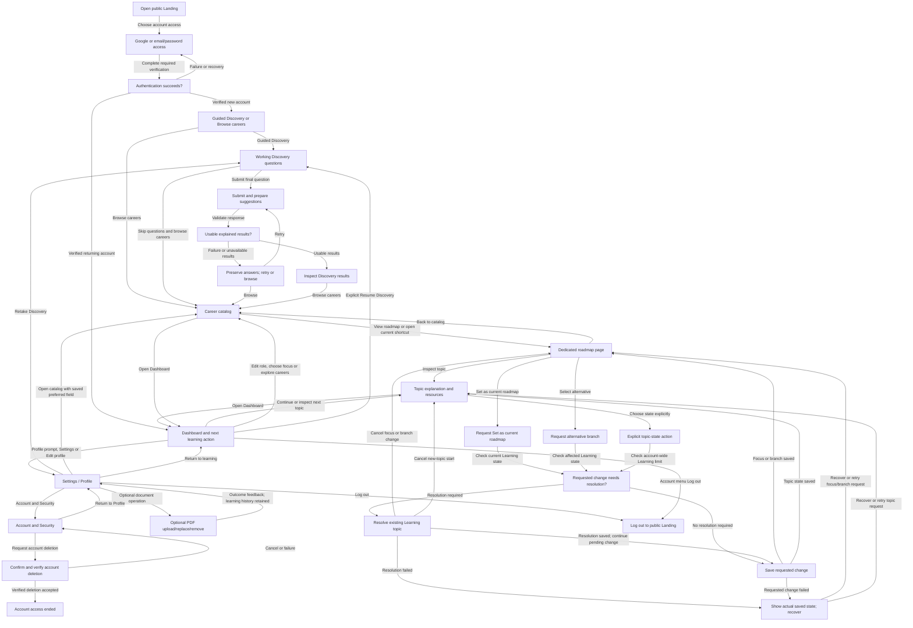

# User journeys

**Version 0.2 · Updated 26 October 2026 · Status: Intended journeys with recorded owner resolutions; feature acceptance pending**

These draft journeys describe intended actions, responses, and recovery, not observed research or implemented behavior. [Product requirements](product.md) own requirements; [pages and interactions](pages-and-interactions.md) own screen details. The flow and student example below illustrate the same journeys without guaranteeing particular recommendations.

[Development](development.md#current-foundation-status-and-evidence) records the implemented local foundation and unfinished integrations. Google/MFA/recovery, saved Discovery, learning/progress and PDF steps below remain intended capabilities; their presence in a journey does not establish runtime support. The originating BRIEF/review provenance gap is recorded in [Decisions](decisions.md#documentation-authority-and-unresolved-integration-records).

## Review boundaries

- The initial release is for adults aged 18 and above across all experience levels; students are the initial design-evaluation group.
- The unfinished Discovery skeleton shows five baseline themes; the intended flow may show different later questions or choice sets based on earlier answers. Assignment A's reviewed route map and F-001 persistence integration remain unfinished; comprehension and quality remain unverified. Earlier questionnaire alternatives are historical references, not additional user choices.
- Canonical roadmap/milestone/topic presentation exists under [Design](design.md); visual approval, current-app manual review and feature interactions remain pending. The journeys describe required behavior, not completed acceptance.
- Six categories and seven launch roles are selected in Product. Authored topic sequences, milestones, learning alternatives and resources still require editorial review/publication. Named examples are not approved curricula.
- Selected profile/security/lifecycle policy is recorded in the [decision register](decisions.md) and security baseline. Provider compatibility and unrun evidence remain release gates.

## J-01: Sign in and browse directly

**User and goal:** a person who wants to explore careers without completing Discovery.

**Starting state:** signed out, or signed in and able to open the catalog.

1. Read the compact public Landing page. Register/sign in with Google or email/password. Email/password registration includes emailed code entry and an explicit Verify action; the final digit does not automatically submit. Resend code and Return to sign-in provide recovery. Entering an email alone does not authenticate.
2. Complete authenticator verification if 2FA is enabled on the account. Password recovery and issued single-use recovery codes provide the specified recovery routes; no undocumented bypass is assumed.
3. A verified new account reaches the entry choice and selects Browse careers (the Free Browsing path). A returning account reaches Dashboard and opens the catalog using Roadmap navigation.
4. Read category context; search role titles or associated skills and filter categories. Discovery is not required for catalog access. A saved Preferred Primary Field supplies the default catalog category only.
5. Use View roadmap on a role card to open its dedicated roadmap URL directly. Read the concise About this career and optionally expand Read more for responsibilities, work examples, and skills.
6. Inspect the expandable milestones and open a topic/resources panel. External resources open in a new tab. Viewing, searching, and reading change neither current roadmap nor topic status.
7. Optionally proceed to J-03 to set current focus and record progress.

**Outcome:** the authenticated user can investigate a role and learning path without a questionnaire or mandatory profile form.

**Recovery:** failed authentication stays recoverable; expired sessions offer reauthentication. No matches offers filter reset. Missing content is identified rather than invented. A failed request must not appear saved.

**Requirements:** REQ-01, REQ-02, REQ-03, REQ-07, REQ-08, REQ-09, REQ-13.

## J-02: Complete or leave guided Discovery

**User and goal:** an authenticated person seeking possible career directions and understandable reasons to explore them.

**Starting state:** new-user entry choice, a deliberate Resume Discovery action, or Retake Discovery in Profile.

1. Choose Guided Discovery. Use the existing themes as the content baseline: general interests, activities/motivations, work approach, experience/background, and goals/context. Earlier answers may determine later questions or choice sets. Use the headings and wording in the [Discovery copy draft](specs/discovery.md#discovery-copy-draft), following the reviewed route map.
2. Apply the applicable checkbox/radio controls, exclusive uncertainty and F-001 background exclusions. Save valid answers on Next/Back checkpoints. Back preserves recoverable answers; route changes follow the reviewed inactive-answer policy. Explicit uncertainty must be supported without interpreting it as dislike or low ability. Profile photos, PDFs, employment history, and technical experience are not prerequisites.
3. At any question, choose Skip questions and browse careers to open the catalog. No answers are invented on the user's behalf. An unfinished saved questionnaire may be resumed later from Dashboard; returning sign-in does not reopen it automatically.
4. Submit the final question and receive processing feedback. Successful results reference available catalog entries and explain the relevant supplied context. No suitability, competence, or job-readiness percentage is displayed.
5. Inspect up to three explained results. Use View roadmap on a result to open its detail, or Browse careers for the full catalog. There is no separate answer-review page, additional mandatory completion page, or required profile setup.
6. Browse suggested and other careers, then open a roadmap. Neither a suggestion nor completion of Discovery sets a current roadmap.

**Outcome:** the user has directions to investigate and remains free to browse alternatives.

**Recovery:** preserve answers on request failure and offer retry or browsing. Invalid/unavailable catalog references must not become fabricated results. A failed retake preserves previous successful recommendations. F-002 defines evidence-based ranking/refresh; only answers active on the submitted route may inform recommendations. Results provide direct View roadmap and full Browse careers.

**Requirements:** REQ-01 through REQ-05, REQ-11, REQ-13.

## J-03: Select focus, study a topic, or change paths

**User and goal:** a signed-in learner who wants to choose a roadmap and work on a concrete topic.

**Starting state:** an opened roadmap, with or without an existing current roadmap or Learning topic.

1. Inspect the role explanation, milestones, topics, and resources without changing saved focus or progress. Prerequisites are advisory; topics may be studied out of order.
2. Choose Set as current roadmap inside detail. If switching from another current roadmap while a topic is Learning, first resolve that topic using Done, Skip, or Clear, or cancel the switch. Save success updates current focus and its Dashboard/catalog shortcut. History remains intact.
3. Where authored alternatives exist, choose a branch. If the change excludes the active Learning topic, resolve it first or cancel. Both branches retain their saved histories; only common topics and the selected branch count toward applicable progress.
4. Open a topic and explicitly choose Learning. If another topic anywhere in the account is Learning, resolve it before starting this one. Merely opening a topic does not start it.
5. Open a curated resource or relevant tool guide. Viewing it neither marks Done nor adds calendar activity.
6. Return to Dashboard and use Continue to reopen the active topic with milestone context.
7. Explicitly mark the topic Done, Skip, or Clear. Clear restores Not started. Each action changes that topic only; parent, child, and sibling statuses remain independent. Done is user-reported completion, not verified mastery.
8. Inspect the next authored suggestion or return to the milestone list. Suggestions bypass Done and Skipped topics; topic status remains unchanged until another explicit action.

**Outcome:** one current roadmap and at most one Learning topic across the account, with roadmap-specific progress retained.

**Recovery:** canceling a conflict leaves the requested switch/start unapplied. Failures must show the actual saved outcome. If resolution saved but a later focus change failed, show that partial outcome honestly. Identical topics in different roadmaps have separate progress.

**Requirements:** REQ-03, REQ-07 through REQ-10, REQ-13.

## J-04: Return and continue from Dashboard

**User and goal:** a returning learner seeking a practical next step without repeating setup.

**Starting state:** successful returning sign-in or Dashboard navigation.

1. Reach Dashboard. If Discovery is unfinished, optionally resume saved answers; learning remains available without doing so.
2. See the explicitly current role with Edit, the current core milestone, and its actual completion percentage. The milestone follows the active Learning topic within the current roadmap; otherwise it is the earliest milestone with an available next topic.
3. Continue an active topic, or open an authored starting/next-topic suggestion. Opening a suggestion does not mark it Learning. With no current roadmap, use Go to Careers.
4. Expand/collapse Not Started, In-Progress, and Complete groups to inspect topics. Skipped topics remain available in the roadmap rather than a Dashboard group.
5. Inspect monthly activity and daily Done counts, navigate earlier months, and view the consecutive-day streak. Learning, browsing, and Skip add no calendar credit. Undoing Done recalculates its contribution and streak. Local-date and timezone rules follow REQ-10.
6. If all applicable topics are Done, see the completion summary and Explore other careers. If remaining topics are only Done/Skipped, see No remaining suggested topics and revisit Skipped; do not show false completion. Neither state changes current focus automatically.
7. Ignore the optional basic-profile guidance, dismiss it across supported pages and future visits, or deliberately open Settings / Profile. The prompt hides after a nonempty First name is saved; photo/PDF remain optional. Settings and the account menu remain available afterward.

**Outcome:** the learner can resume or choose another action while seeing honest activity and milestone progress.

**Recovery:** unavailable data does not become fabricated progress. Profile incompleteness does not block learning. Changing focus or preferences does not erase prior learning records.

**Requirements:** REQ-01, REQ-02, REQ-07 through REQ-11, REQ-13.

## J-05: Retake Discovery or adjust catalog preferences

**User and goal:** an existing account updating exploration context without resetting learning.

1. Open Settings / Profile from the header or Edit profile in the account menu.
2. Inspect available saved Discovery context. Choose Retake Discovery and revisit the working question sequence with saved answers where applicable.
3. Submit the updated answers. A successful retake refreshes recommendation context; failure preserves earlier successful results and offers recovery.
4. Open Careers and inspect suggestions or browse independently. Current roadmap and topic states stay unchanged unless explicitly edited through their own controls.
5. Independently, select/save Preferred Primary Field to change the catalog's default category. This preference does not itself change recommendations, Discovery answers, focus, or progress.

**Outcome:** saved Discovery context and catalog preference remain distinct from the current learning path.

**Update policy:** editing an answer recomputes the applicable route; the reviewed policy governs answers that become inactive. Final Discovery submission requests once; focus/branch/progress/PDF changes mark recommendations outdated for explicit Update suggestions in Careers. Same revisions reuse saved results; no changed ranking is promised.

**Requirements:** REQ-02, REQ-04, REQ-05, REQ-08, REQ-09, REQ-11, REQ-13.

## J-06: Optionally enrich Profile and manage a PDF

**User and goal:** an account holder who wants to add personal details or explicitly documented background.

1. Open Settings / Profile, optionally through shared contextual guidance on Dashboard or Careers. A separately presented enrichment form is an optional destination, not a required onboarding step.
2. Edit First name, optional Surname, and optional photo. Choose Save profile; preferred category uses its separate Save preferences action. A nonempty saved First name satisfies the Dashboard profile-completion rule.
3. Optionally choose a selectable-text PDF resume, academic record, or project/work summary up to 10 MB. Read the explanation of how it is used and any external processing before upload.
4. Choose Analyze PDF to authorize upload/analysis after reading the disclosure, and see distinct stage feedback. Successful analysis automatically applies explicitly stated skills, education, work, and projects to document-derived context. No mandatory extraction-review screen or editable skills form is included.
5. Replace the PDF if desired. Preserve previous successful context during processing or failure; supersede it only when replacement analysis succeeds. A readable file with no usable background preserves earlier successful context and reports that outcome.
6. Confirm Remove PDF if desired. Remove active/pending document context, suppress document-dependent recommendations, offer refresh from remaining inputs, and prevent pending analysis from restoring it. Keep current roadmap and progress unchanged.
7. Return to learning at any time without requiring a photo, Surname, or PDF. Dismissing/backing out of unsaved enrichment must not appear as a successful save.

**Outcome:** optional personal/document context is saved separately from learning records. Retain the active original PDF until replacement, removal, or account deletion, subject to the selected physical-deletion/backup policy in [Security and operations](security-and-operations.md).

**Recovery:** unsupported/scanned, oversized, unreadable, failed, and timed-out files produce honest feedback without replacing prior successful context. Correct extracted information through Replace or Remove for MVP. No competence is invented from a degree or job title.

**Requirements:** REQ-05, REQ-10, REQ-11, REQ-13; NFR-04 through NFR-07.

## J-07: Protect or end account access

**User and goal:** an account holder managing sign-in security or leaving the service.

1. Open Settings / Account and Security. Optional 2FA enrollment uses an authenticator app only; SMS, email-code 2FA, and push approval are outside MVP.
2. Configure the authenticator using the provided setup information and verify its code. Activate only after successful verification. Receive single-use recovery codes and save them for future access recovery.
3. After primary sign-in, complete the enabled second factor or use an issued valid provider recovery code. Backend application-data access remains blocked until AAL2; AUTH-C2 must be verified. Successful use invalidates that recovery code. Password recovery does not imply a 2FA bypass.
4. If linking Google to an existing email/password account, explicitly request linking and prove access to the existing account. A matching email string alone is insufficient. Preserve the account's history.
5. To end a visit, choose Log out in the account menu or Settings; return to public Landing.
6. To leave permanently, request account deletion, review consequences, explicitly confirm, and complete appropriate identity verification. Confirmed deletion ends access immediately and starts removal without a restoration grace period.

**Outcome:** protected account actions have explicit intent and truthful feedback. Downloadable data export is outside MVP.

**Security policy:** fresh primary authentication plus existing factor for sensitive changes, provider-managed recovery only, and selected purge/backup deadlines follow Security and operations. AUTH-C1/C2 provider gates remain required. Failed or ambiguous security operations must not appear successful.

**Requirements:** REQ-01, REQ-11, REQ-13; NFR-05, NFR-06.

## Cross-journey constraints

- Recommendations are advisory, catalog-grounded, and intended to adapt to relevant Discovery, explicit roadmap, topic-progress, and optional document inputs. F-002 defines permitted input interpretation, explicit refresh and stale-context handling. Recorded completion is not proof of mastery or career preference.
- Current roadmap changes only by Set as current roadmap. Topic states change only through explicit saved actions. Neither profile edits nor recommendations silently reset learning.
- Career comparison, standalone bookmarking, conversational tutoring, AI-generated roadmaps, and career videos are not introduced by these journeys.
- Accessibility, responsive presentation, reliability, security, service-failure behavior, and selected quality targets remain governed by NFR-01 through NFR-10.

## Navigation flow

Diagram edges show available user actions, not automatic navigation after saving. The journeys above define recovery and invariants; [pages and interactions](pages-and-interactions.md) defines local controls and state feedback.

## Student example

Illustrative adult student exploring software-related work; not an approved curriculum or guaranteed recommendation.

The example follows F-001's baseline wording/control policy and F-002's recommendation boundaries. It does not define the conditional route map. Authored versioned question/option publication, persisted services, comprehension and quality evidence remain unfinished. Milestone-list/panel behavior is selected; zoom/reflow evidence and actual curricula remain unfinished. Backend, Internet fundamentals and HTTP below are illustrative content, not an approved launch selection or guaranteed recommendation.

### Entry and exploration

| Step | Screen | Student action | System response |
| --- | --- | --- | --- |
| E01 | LANDING / AUTH-REGISTER | Register using email/password or Google. | Complete applicable verification; a verified new account reaches ENTRY-CHOICE. Email entry alone does not authenticate. |
| E02 | ENTRY-CHOICE | Choose Guided Discovery. | Open DISC-INTERESTS. Choosing Browse careers instead opens CAREERS-CATALOG directly. |
| E03 | DISC-INTERESTS | Express interest in creating useful tools. | Save/retain the answer using F-001's selected controls/checkpoints; continue to activities. No fixed career is inferred from this answer alone. |
| E04 | DISC-ACTIVITIES | Express interest in useful software or automation. | Continue to work approach under F-001's wording/selection policy; automation does not imply AI interest. |
| E05 | DISC-WORK-APPROACH | Express an approach or uncertainty. | Continue to background without claiming this preference measures technical ability. |
| E06 | DISC-BACKGROUND | Indicate being new to tech. | No employment, prior skills, profile photo or PDF is required. |
| E07 | DISC-GOALS | Indicate a goal of starting to learn; submit. | Show processing, then usable explained results or recovery feedback. No separate answer-review page. |
| E08 | DISC-RESULTS | Read directions to explore; choose Browse careers. | Open the catalog without automatically setting a current roadmap. No suitability percentages or extra mandatory completion page. |
| E09 | CAREERS-CATALOG | Search software roles/skills or browse category cards. | Full catalog remains available regardless of suggestions. The actual recommended roles are not predetermined by this script. |

At any question, Skip questions and browse careers opens the catalog. Back retains answers. If the student leaves unfinished Discovery, subsequent sign-in reaches Dashboard with optional Resume Discovery, rather than reopening questions automatically.

### Inspect a roadmap and begin learning

| Step | Screen | Student action | System response |
| --- | --- | --- | --- |
| L01 | CAREERS-CATALOG | Use View roadmap for Backend as an illustrative example. | Navigate to ROADMAP-DETAIL at its dedicated URL. Opening does not make it current. |
| L02 | ROADMAP-DETAIL | Read About this career and expand Read more. | Reveal curated responsibilities, examples and relevant skills without changing focus. |
| L03 | ROADMAP-DETAIL / TOPIC-PANEL | Inspect the expandable milestones and open an introductory topic. | Show explanation, at least one free curated resource and relevant tool guidance. No state changes from viewing. |
| L04 | ROADMAP-DETAIL | Choose Set as current roadmap inside detail. | On save success, show current focus in the roadmap, Dashboard and catalog shortcut. For this new account, no existing Learning topic needs resolution. |
| L05 | DASHBOARD | Open the offered starting topic. | Open TOPIC-PANEL without marking it Learning. The optional Profile Enrichment prompt may be ignored. |
| L06 | TOPIC-PANEL | Explicitly choose Learning, then open a resource. | Save Learning; resource opens in a new tab and adds no completion credit. |
| L07 | DASHBOARD | Return and choose Continue. | Show the current core milestone, such as Internet fundamentals, and reopen the active topic. |
| L08 | TOPIC-PANEL | Mark Done. | Replace Learning with Done for this topic only. Parent/child topics remain unchanged. |
| L09 | DASHBOARD | Inspect progress and suggested next. | Show actual milestone completion, Done activity and streak under local-date rules; offer the next authored topic. These are not competence scores. |
| L10 | TOPIC-PANEL | Open HTTP as the next example; choose Learning when ready. | Opening alone changes nothing; an explicit Learning action saves the status. |
| L11 | ROADMAP-DETAIL | Attempt to start another topic or switch current roadmap. | If another topic is still Learning, require Done, Skip or Clear first; Cancel leaves the requested change unapplied. |
| L12 | CAREERS-CATALOG | Use the current-roadmap shortcut. | Open the explicitly current roadmap directly. Browsing another role preserves focus until another successful Set as current roadmap. |

Only one topic may be Learning across the account. Different roadmaps retain independent progress. Alternative branch changes preserve history and require resolution if they exclude the active topic. Skipped remains unfinished; only Done counts toward completion.

### Optional Profile and account detour

| Step | Screen | Student action | System response |
| --- | --- | --- | --- |
| P01 | DASHBOARD / ACCOUNT-MENU | Choose Profile Enrichment or Edit profile. | Open Settings / Profile. This is an optional detour, not onboarding. |
| P02 | SETTINGS-PROFILE | Save a nonempty First name; optionally Surname/photo. | Save profile explicitly, independently of Save preferences. Name persistence exists; photo processing and cross-page guidance integration remain unfinished. Intended success hides the basic-profile prompt; photo/PDF remain optional. |
| P03 | SETTINGS-PROFILE | Optionally upload a supported selectable-text PDF up to 10 MB. | Show separate upload/analysis states. On success, automatically apply explicitly documented background without a mandatory extraction review or skills editor. |
| P04 | SETTINGS-PROFILE | Replace or remove the PDF. | Replacement applies only after successful analysis; removal clears active document context and prevents stale reapplication. Preserve focus and progress. |
| P05 | SETTINGS-PROFILE | Save Preferred Primary Field or Retake Discovery. | Preferred field changes the default catalog category only. A successful retake updates recommendation context without changing current roadmap. |
| P06 | SETTINGS-ACCOUNT | Optionally enroll an authenticator app. | Verify before activation and issue single-use recovery codes. Other pictured 2FA methods are outside MVP. |
| P07 | ACCOUNT-MENU / Settings | Log out, then return another day. | Return to Landing; successful returning sign-in reaches Dashboard. Complete enabled 2FA if applicable. |

### Recovery and completion states

- Failed saves remain visibly unsaved; preserve recoverable input. Do not claim a rollback if a prior resolution already saved.
- Failed Discovery requests preserve answers and earlier successful recommendations, with retry/browsing available.
- Invalid, scanned, oversized, or failed PDF input does not replace prior successful document context. A saved name does not depend on analysis success.
- Done activity is deduplicated per roadmap topic per local day; undoing Done removes its contribution and recalculates streaks.
- If all applicable topics are Done, show a completion summary without changing current focus. If only Done/Skipped remain, show No remaining suggested topics and a route to revisit Skipped rather than false completion.
- Milestone-list presentation, baseline Discovery controls and launch-role inventory are selected; the conditional Discovery route map remains to be authored. Visual/manual acceptance, authored curricula, persistence, comprehension, security/lifecycle implementation and zoom/reflow evidence remain pending. A graph canvas is not required. Mobile-specific presentation is outside MVP scope under [NFR-02](product.md#nfr-02-desktop-compatibility-and-accessible-reflow).
